<!-- ========== HEADER ========== -->

<a href="https://hossamcodes.com/">

  

 

<!-- ========== ABOUT ========== -->
## 

I'm a developer who builds **native iOS apps** with Swift & SwiftUI and **professional WordPress websites** for businesses and online stores. I focus on clean code, smooth user experience, and shipping products that work.

struct Developer {
    let name       = "Hossam Osama"
    let role       = ["iOS Developer", "WordPress Developer"]
    let currently  = "Working as a WordPress Developer"
    let learning   = ["Advanced SwiftUI", "SwiftData", "Swift Concurrency"]
    let openTo     = ["iOS Projects", "WordPress & WooCommerce", "Remote Roles"]
    let location   = "Egypt 🇪🇬"

    func motto() -> String {
        "Always learning. Always building."
    }
}

 

<!-- ========== WHAT I DO ========== -->
## 

<table>
<tr>
<td width="50%" valign="top">

### 📱 iOS Development
- Native apps with **Swift & SwiftUI**
- **MVVM** & clean architecture
- Local persistence with **SwiftData**
- Networking with **async/await** & **Codable**
- **Firebase** integration
- Cross-platform apps with **Flutter**

</td>
<td width="50%" valign="top">

### 🌐 WordPress Development
- Custom themes & **Elementor** builds
- **WooCommerce** online stores
- Custom functionality with **PHP**
- Speed & performance optimization
- Responsive, **SEO-friendly** websites
- **MySQL** database management

</td>
</tr>
</table>

 

<!-- ========== TECH STACK ========== -->
## 

**📱 Mobile**

  

**🌐 Web & WordPress**

  

**🛠 Tools**

 

<!-- ========== GITHUB STATS ========== -->
## 

<picture>
  <source media="(prefers-color-scheme: dark)" srcset="https://raw.githubusercontent.com/hossam556k/hossam556k/output/github-contribution-grid-snake-dark.svg"/>
  <source media="(prefers-color-scheme: light)" srcset="https://raw.githubusercontent.com/hossam556k/hossam556k/output/github-contribution-grid-snake.svg"/>
  
</picture>

 

<!-- ========== FOOTER ========== -->

